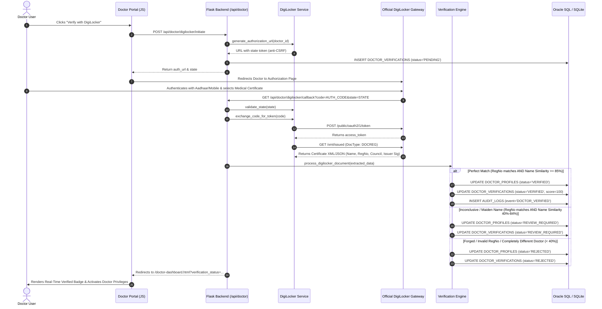
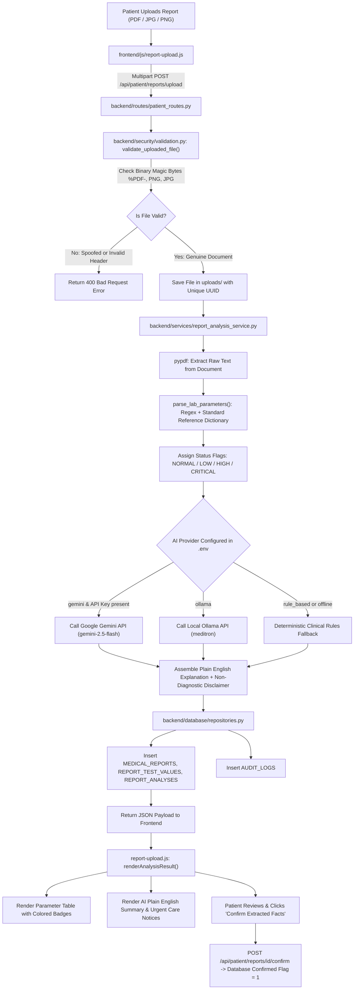
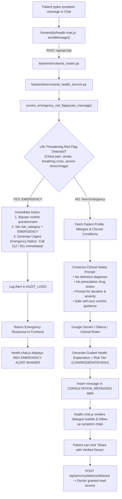

# AI Health Agent — Complete Architecture, Flowcharts & File Map

This document provides a detailed, comprehensive blueprint of the entire **AI Health Agent** system. It explains **how every single part connects** (Frontend $\leftrightarrow$ Flask Backend $\leftrightarrow$ Oracle SQL / Database $\leftrightarrow$ External APIs), **which code does which task in every folder**, and includes **visual flowcharts** for each core workflow.

---

## 1. End-to-End System Architecture Flowchart

```mermaid
flowchart TD
    subgraph Frontend["1. FRONTEND TIER (Vanilla HTML5 / CSS3 / JavaScript)"]
        UI_Home["Landing Page (index.html)"]
        UI_PatientAuth["Patient Auth (patient-login.html & register)"]
        UI_DoctorAuth["Doctor Auth (doctor-login.html & register)"]
        UI_PatientDash["Patient Dashboard (patient-dashboard.html)"]
        UI_DoctorDash["Doctor Dashboard (doctor-dashboard.html)"]
        UI_Report["Report Viewer (report-analysis.html)"]
        UI_Chat["Health Chat (health-chat.html)"]
        UI_Apt["Appointments & Search (doctor-search.html)"]
        UI_Med["Medicines & Checker (medicine-search.html)"]

        JS_Auth["auth.js (JWT & Route Guards)"]
        JS_Verify["doctor-verification.js (DigiLocker Client)"]
        JS_Report["report-upload.js (Dropzone & OCR Table)"]
        JS_Chat["health-chat.js (Triage & Messages)"]
        JS_Apt["appointments.js (Booking & Slots)"]
    end

    subgraph Backend["2. BACKEND TIER (Python Flask REST API)"]
        AppServer["app.py (Server Factory & Static Servicing)"]
        Config["config.py (Env Settings & Paths)"]
        
        subgraph Security["Security & Middleware (backend/security/)"]
            Sec_Auth["auth.py (BCrypt, PyJWT, Decorators)"]
            Sec_Val["validation.py (Magic Bytes & Regex)"]
            Sec_Rate["rate_limiter.py (Token Bucket)"]
            Sec_Audit["audit.py (Event Logging)"]
        end

        subgraph Routes["API Routes (backend/routes/)"]
            R_Auth["auth_routes.py (/api/auth)"]
            R_Doctor["doctor_routes.py (/api/doctor)"]
            R_Patient["patient_routes.py (/api/patient)"]
            R_AI["ai_routes.py (/api/ai)"]
            R_Apt["appointment_routes.py (/api/appointments)"]
            R_Med["medicine_routes.py (/api/medicines)"]
            R_Prod["product_routes.py (/api/products)"]
        end

        subgraph Services["Business Logic Services (backend/services/)"]
            S_Digi["digilocker_service.py (OAuth2 & Sandbox)"]
            S_DocVerif["doctor_verification_service.py (State Machine)"]
            S_Report["report_analysis_service.py (Lab OCR & AI)"]
            S_AI["ai_health_service.py (Red-Flag Triage)"]
            S_Med["medicine_service.py (Drug Interactions)"]
            S_Prod["product_service.py (Spelling Suggestions)"]
        end
    end

    subgraph Data["3. DATA & PERSISTENCE TIER"]
        DB_Conn["connection.py (Dual-Mode Connection Pool)"]
        DB_Repo["repositories.py (11 ANSI SQL Repositories)"]
        OracleDB[("Oracle Database 19c/21c/23ai (python-oracledb)")]
        SQLiteDB[("SQLite Local Fallback (ai_health.db)")]
        UploadsFolder["uploads/ (Validated Reports Storage)"]
    end

    subgraph External["4. EXTERNAL GATEWAYS & AI"]
        DigiLockerAPI["DigiLocker / API Setu Gateway (OAuth2 & DOCREG)"]
        GeminiAPI["Google Gemini AI API (gemini-2.5-flash)"]
        OllamaAPI["Ollama Local Model (meditron / llama3)"]
        Pharmacies["Legitimate Pharmacies (1mg, Apollo, Netmeds)"]
    end

    %% Frontend connections
    UI_PatientDash --> JS_Auth & JS_Report & JS_Chat & JS_Apt
    UI_DoctorDash --> JS_Auth & JS_Verify
    JS_Auth -->|HTTP JSON Bearer Token| R_Auth
    JS_Verify -->|Initiate / Callback / Sandbox| R_Doctor
    JS_Report -->|Multipart Form-Data| R_Patient
    JS_Chat -->|Chat Dialogue JSON| R_AI
    JS_Apt -->|Booking JSON| R_Apt

    %% Backend Routing
    AppServer --> Routes
    Routes --> Security
    R_Auth --> Sec_Auth & Sec_Val
    R_Doctor --> S_Digi & S_DocVerif
    R_Patient --> S_Report & Sec_Val
    R_AI --> S_AI
    R_Apt --> DB_Repo
    R_Med --> S_Med
    R_Prod --> S_Prod

    %% Services to Data & External
    S_Digi <-->|OAuth2 Token Exchange| DigiLockerAPI
    S_DocVerif --> DB_Repo & Sec_Audit
    S_Report --> UploadsFolder & GeminiAPI & OllamaAPI & DB_Repo
    S_AI --> GeminiAPI & OllamaAPI & DB_Repo
    S_Med --> DB_Repo & Pharmacies
    S_Prod --> DB_Repo

    %% Database Abstraction
    DB_Repo --> DB_Conn
    DB_Conn -->|DB_TYPE=oracle| OracleDB
    DB_Conn -->|DB_TYPE=sqlite| SQLiteDB
```

---

## 2. Core Workflow Flowcharts

### Workflow A: DigiLocker Doctor Verification State Machine

---

### Workflow B: AI Medical Report Upload & Plain English Explanation

---

### Workflow C: Conversational AI Health Triage & Red-Flag Screening

---

## 3. Comprehensive File-by-File & Folder Guide

### Folder: `backend/`

| File Path | Tasks & Responsibilities | Key Functions / Methods | Connections & Flow |
| :--- | :--- | :--- | :--- |
| **`backend/app.py`** | Flask application factory, server startup, blueprint registrations, static frontend serving, security headers, and global error handlers. | `create_app()`, `set_security_headers()`, `serve_index()`, `serve_frontend_files()`, error handlers (400, 401, 403, 404, 413, 500). | Imports all 7 route blueprints. Serves `frontend/` files to browser. Entry point when running `python backend/app.py`. |
| **`backend/config.py`** | Central configuration module. Loads `.env` file variables (JWT keys, Oracle DSN, SQLite path, Gemini key, DigiLocker credentials). | `Config` class attributes (`SECRET_KEY`, `JWT_SECRET_KEY`, `DB_TYPE`, `ORACLE_USER`, `DIGILOCKER_CLIENT_ID`, `GEMINI_API_KEY`). | Read by `connection.py`, `auth.py`, `digilocker_service.py`, `report_analysis_service.py`, `ai_health_service.py`. |
| **`backend/requirements.txt`** | Dependency manifest. Lists all Python packages (Flask, oracledb, bcrypt, PyJWT, pypdf, Pillow, requests, python-dotenv, pytest). | Package specifications. | Installed via `pip install -r backend/requirements.txt`. |

---

### Folder: `backend/security/`

| File Path | Tasks & Responsibilities | Key Functions / Methods | Connections & Flow |
| :--- | :--- | :--- | :--- |
| **`backend/security/auth.py`** | Cryptographic password hashing, JWT token creation, token decoding, and role protection decorators. | `hash_password()`, `check_password()`, `generate_jwt_token()`, `decode_jwt_token()`, `@jwt_required`, `@role_required()`, `@verified_doctor_required`. | Uses `bcrypt` and `jwt`. Used by `auth_routes.py`, `doctor_routes.py`, `patient_routes.py`, `ai_routes.py`, and `appointment_routes.py`. |
| **`backend/security/validation.py`** | Server-side input validation, HTML sanitization, and binary magic bytes validation for file uploads. | `validate_email()`, `validate_phone()`, `validate_password_strength()`, `sanitize_input()`, `validate_uploaded_file()`. | Inspects file byte signatures (`%PDF-`, PNG, JPG). Called by `auth_routes.py` and `patient_routes.py`. |
| **`backend/security/rate_limiter.py`** | In-memory token-bucket rate limiter preventing brute-force attacks on sensitive endpoints. | `rate_limit(max_requests, window_seconds)`. | Decorator applied to `/api/auth/login`, `/api/auth/patient/register`, and `/api/auth/doctor/register`. |
| **`backend/security/audit.py`** | Records immutable security and clinical audit trails. | `log_audit_event(event_type, target_resource, ...)`. | Calls `AuditRepository.log()`. Invoked during logins, registrations, verifications, report uploads, and emergency flags. |

---

### Folder: `backend/services/`

| File Path | Tasks & Responsibilities | Key Functions / Methods | Connections & Flow |
| :--- | :--- | :--- | :--- |
| **`backend/services/digilocker_service.py`** | DigiLocker / API Setu OAuth 2.0 integration client, state/nonce generator, token exchange, and sandbox simulator. | `generate_authorization_url()`, `validate_state()`, `exchange_code_for_token()`, `fetch_doctor_registration_doc()`, `get_sandbox_credential_payload()`. | Communicates via HTTP with DigiLocker API Setu endpoints. Called by `doctor_routes.py`. |
| **`backend/services/doctor_verification_service.py`** | Multi-tier doctor verification state machine. Computes fuzzy name similarity and checks registration authenticity. | `normalize_name()`, `normalize_reg_no()`, `calculate_name_similarity()`, `process_digilocker_document()`. | Determines `VERIFIED`, `REVIEW_REQUIRED`, or `REJECTED`. Updates `DOCTOR_PROFILES` and `DOCTOR_VERIFICATIONS` via repositories. |
| **`backend/services/report_analysis_service.py`** | Extracts text from PDF reports, identifies lab parameters, compares to reference intervals, and generates AI explanations. | `extract_text_from_file()`, `parse_lab_parameters()`, `generate_ai_explanation()`. | Uses `pypdf`, regex heuristics, standard lab ranges, and Google Gemini API / Ollama. Called by `patient_routes.py`. |
| **`backend/services/ai_health_service.py`** | Safe conversational AI triage assistant, acute red-flag emergency screening, and follow-up generation. | `screen_emergency_red_flags()`, `generate_health_guidance()`. | Enforces clinical safety boundaries (no prescriptions, no diagnoses). Calls Gemini API / Ollama / Fallback. Called by `ai_routes.py`. |
| **`backend/services/medicine_service.py`** | Medicine compendium search, pharmacological indications, and pairwise drug-drug interaction matrix. | `search()`, `get_details()`, `check_interactions()`. | Queries `MEDICINE_INFORMATION` and `DRUG_INTERACTIONS`. Called by `medicine_routes.py`. |
| **`backend/services/product_service.py`** | Health devices and OTC wellness product catalog with fuzzy spelling suggestions. | `search()`, `get_categories()`, `get_details()`. | Uses `difflib` for spelling tolerance. Queries `HEALTH_PRODUCTS`. Called by `product_routes.py`. |

---

### Folder: `backend/database/`

| File Path | Tasks & Responsibilities | Key Functions / Methods | Connections & Flow |
| :--- | :--- | :--- | :--- |
| **`backend/database/connection.py`** | Dual-mode database manager. Handles Oracle Database connection pool via `python-oracledb` and local SQLite fallback. Auto-bootstraps tables and seeds. | `DatabaseManager`, `_init_sqlite()`, `_bootstrap_sqlite_schema()`, `_seed_sqlite_initial_data()`, `get_connection()`, `execute_query()`. | Standardizes named parameters (`:param_name`) across Oracle and SQLite. Used by all repositories. |
| **`backend/database/repositories.py`** | Data Access Layer (DAL) containing 11 repository classes with parameterized ANSI SQL queries. | `UserRepository`, `PatientProfileRepository`, `DoctorProfileRepository`, `DoctorVerificationRepository`, `MedicalReportRepository`, `ConsultationRepository`, `MedicineRepository`, `ProductRepository`, `AppointmentRepository`, `ConsentRepository`, `AuditRepository`. | Executes CRUD operations on the database. Invoked by route controllers and services. |

---

### Folder: `backend/routes/`

| File Path | Tasks & Responsibilities | Key Endpoints | Connections & Flow |
| :--- | :--- | :--- | :--- |
| **`backend/routes/auth_routes.py`** | User authentication, patient & doctor registration, JWT cookie setting, session inspection (`/me`), and logout. | `POST /api/auth/patient/register`, `POST /api/auth/doctor/register`, `POST /api/auth/login`, `GET /api/auth/me`, `POST /api/auth/logout`. | Called by `frontend/js/auth.js`. Uses `auth.py`, `validation.py`, and `repositories.py`. |
| **`backend/routes/doctor_routes.py`** | DigiLocker flow initiation, OAuth2 callback handler, sandbox simulation triggers, and doctor dashboard data. | `POST /api/doctor/digilocker/initiate`, `GET /api/doctor/digilocker/callback`, `POST /api/doctor/digilocker/sandbox-verify`, `GET /api/doctor/verification/status`, `GET /api/doctor/dashboard/stats`, `GET /api/doctor/dashboard/consultations`. | Called by `frontend/js/doctor-verification.js`. Invokes `digilocker_service.py` and `doctor_verification_service.py`. |
| **`backend/routes/patient_routes.py`** | Patient demographic updates, report uploads with magic bytes check, OCR lab extraction, patient confirmation, and trends. | `GET /api/patient/profile`, `PUT /api/patient/profile`, `POST /api/patient/reports/upload`, `POST /api/patient/reports/<id>/confirm`, `GET /api/patient/reports`, `GET /api/patient/reports/compare`. | Called by `frontend/js/report-upload.js`. Uses `validation.py` and `report_analysis_service.py`. |
| **`backend/routes/ai_routes.py`** | Multi-turn health consultation chat, emergency screening, dialogue retrieval, and sharing transcripts with doctors. | `POST /api/ai/chat`, `GET /api/ai/consultations`, `GET /api/ai/consultations/<id>`, `POST /api/ai/consultations/<id>/share`. | Called by `frontend/js/health-chat.js`. Uses `ai_health_service.py` and `ConsultationRepository`. |
| **`backend/routes/appointment_routes.py`** | Doctor directory search, slot scheduling, appointment lifecycle status updates (confirm, cancel, reschedule). | `GET /api/appointments/doctors`, `POST /api/appointments/book`, `GET /api/appointments/my`, `PUT /api/appointments/<id>/status`. | Called by `frontend/js/appointments.js`. Uses `DoctorProfileRepository` and `AppointmentRepository`. |
| **`backend/routes/medicine_routes.py`** | Drug compendium search, indications, contraindications, and multi-drug interaction checking. | `GET /api/medicines/search`, `GET /api/medicines/<id>`, `POST /api/medicines/check-interactions`. | Called by `frontend/medicine-search.html`. Uses `medicine_service.py`. |
| **`backend/routes/product_routes.py`** | Search medical devices and OTC products with category filters and spelling suggestions. | `GET /api/products/search`, `GET /api/products/categories`, `GET /api/products/<id>`. | Called by `frontend/patient-dashboard.html`. Uses `product_service.py`. |

---

### Folder: `frontend/`

| File Path | Tasks & Responsibilities | Key Interactive Elements | Associated JS / CSS |
| :--- | :--- | :--- | :--- |
| **`frontend/index.html`** | Public portal homepage. Presents value proposition, DigiLocker doctor verification showcase, features, and medical disclaimer. | Hero dual CTAs, DigiLocker spotlight banner, feature cards, emergency notification bar. | Uses `css/style.css` and `js/auth.js`. |
| **`frontend/patient-login.html`** | Secure patient login page. Captures credentials and stores JWT in `localStorage` & cookies. | Email/password form, client feedback alerts, link to patient register. | Uses `css/forms.css` and `js/auth.js`. |
| **`frontend/patient-register.html`** | Patient registration. Collects demographics, allergies, chronic conditions, and mandatory health & privacy consents. | Form inputs, blood group picker, explicit consent checkboxes, submit button. | Submits to `/api/auth/patient/register`. Uses `js/auth.js`. |
| **`frontend/doctor-login.html`** | Medical practitioner login. Displays demo doctor credentials for instant testing. | Form inputs, status feedback alert, link to doctor register. | Uses `css/forms.css` and `js/auth.js`. |
| **`frontend/doctor-register.html`** | Doctor registration. Collects qualification, registration number, council, and verification consent. | Prominent DigiLocker verification callout, credential fields, submit button. | Submits to `/api/auth/doctor/register` and routes to DigiLocker verification. |
| **`frontend/patient-dashboard.html`** | Tabbed patient portal. Consolidates profile, AI chat, report uploader, doctor finder, appointments, medicines, and products. | 8 functional tabs (`overview`, `ai-assistant`, `reports`, `doctors`, `appointments`, `medicines`, `products`, `profile`). | Uses `dashboard.css`, `auth.js`, `report-upload.js`, `health-chat.js`, `appointments.js`. |
| **`frontend/doctor-dashboard.html`** | Verified doctor portal. Displays DigiLocker status card, sandbox simulator modal, appointment manager, and shared patient files. | DigiLocker status banner, Verify button, Sandbox simulator modal, Appointment confirm/decline buttons. | Uses `dashboard.css`, `auth.js`, `doctor-verification.js`. |
| **`frontend/report-analysis.html`** | Dedicated medical report viewer and longitudinal parameter comparison page. | Drag-and-drop dropzone, extracted values table, AI summary card, parameter trend tool. | Uses `js/report-upload.js` and `js/auth.js`. |
| **`frontend/health-chat.html`** | Fullscreen conversational AI health consultation page. | Dialogue container, emergency red-flag banner, quick symptom chips, share with doctor modal. | Uses `js/health-chat.js` and `js/auth.js`. |
| **`frontend/doctor-search.html`** | Dedicated practitioner directory. Filters doctors by specialty, jurisdiction, and name. | Search filter bar, verified doctor cards, appointment booking modal. | Uses `js/appointments.js` and `js/auth.js`. |
| **`frontend/appointments.html`** | Dedicated appointment schedule manager for patients and doctors. | Appointment list table, status tags (`BOOKED`, `CONFIRMED`, `CANCELLED`), cancellation button. | Uses `js/appointments.js` and `js/auth.js`. |
| **`frontend/medicine-search.html`** | Dedicated pharmacology compendium and pairwise drug interaction checker. | Medicine search input, interaction checkbox matrix, analyze button, pharmacy buy links. | Uses `css/dashboard.css` and inline API fetchers. |

---

### Folder: `frontend/js/` & `frontend/css/`

| File Path | Tasks & Responsibilities | Key Functions / Classes |
| :--- | :--- | :--- |
| **`frontend/js/auth.js`** | Client-side auth manager. Manages JWT in `localStorage` and `fetchWithAuth()` wrapper with automatic 401 interception. | `Auth.getToken()`, `Auth.setToken()`, `Auth.fetchWithAuth()`, `Auth.login()`, `Auth.logout()`, `Auth.guardPage()`, `Auth.updateHeaderNav()`. |
| **`frontend/js/doctor-verification.js`** | DigiLocker OAuth2 initiation, sandbox scenario triggering, status polling, and banner rendering. | `DoctorVerification.initiateDigiLockerFlow()`, `DoctorVerification.triggerSandboxScenario()`, `DoctorVerification.loadVerificationStatus()`, `DoctorVerification.renderStatusBanner()`. |
| **`frontend/js/report-upload.js`** | Drag-and-drop file upload, multipart submission, lab values table rendering, AI explanation display, confirmation, and comparison. | `ReportUpload.initDropzone()`, `ReportUpload.submitUpload()`, `ReportUpload.renderAnalysisResult()`, `ReportUpload.confirmReport()`, `ReportUpload.loadHistory()`, `ReportUpload.compareParameter()`. |
| **`frontend/js/health-chat.js`** | Conversational UI manager. Appends messages, renders Markdown formatting, displays red flag banners, and manages doctor sharing. | `HealthChat.initChat()`, `HealthChat.sendMessage()`, `HealthChat.appendMessage()`, `HealthChat.showEmergencyBanner()`, `HealthChat.openShareModal()`, `HealthChat.submitShareWithDoctor()`. |
| **`frontend/js/appointments.js`** | Doctor directory search, booking modal management, appointment lifecycle actions, and cancellations. | `Appointments.searchDoctors()`, `Appointments.openBookModal()`, `Appointments.submitBooking()`, `Appointments.loadMyAppointments()`, `Appointments.cancelAppointment()`. |
| **`frontend/css/style.css`** | Global design system. Clinical color tokens, typography, navbar, buttons, alert banners, cards, and footers. | Custom variables (`--primary`, `--secondary`, `--danger`, `--digilocker-blue`), utility classes, responsive grid. |
| **`frontend/css/dashboard.css`** | Dashboard layouts. Sidebar navigation, stat cards, data tables, chat dialogue bubbles, and modal overlays. | `.dashboard-layout`, `.chat-container`, `.chat-bubble`, `.doc-verify-banner`, `.modal-overlay`. |
| **`frontend/css/forms.css`** | Form styling. Input fields, floating labels, checkboxes, DigiLocker branded button, and drag-and-drop file dropzone. | `.auth-card`, `.form-control`, `.btn-digilocker`, `.dropzone`, `.alert`. |

---

### Folder: `database/`

| File Path | Tasks & Responsibilities | Key Database Entities |
| :--- | :--- | :--- |
| **`database/schema.sql`** | Oracle Database DDL script defining 15 normalized tables, constraints, foreign keys, timestamps, and performance indexes. | `USERS`, `PATIENT_PROFILES`, `DOCTOR_PROFILES`, `DOCTOR_VERIFICATIONS`, `MEDICAL_REPORTS`, `REPORT_ANALYSES`, `REPORT_TEST_VALUES`, `CONSULTATIONS`, `CONSULTATION_MESSAGES`, `MEDICINE_INFORMATION`, `DRUG_INTERACTIONS`, `HEALTH_PRODUCTS`, `APPOINTMENTS`, `USER_CONSENTS`, `AUDIT_LOGS`. |
| **`database/sample_data.sql`** | Seed data for development and testing. Contains verified doctors, pending doctors, test patient, realistic medical reports, medicines, drug interactions, and products. | Seed records with genuine BCrypt hashes (`Password123!`), doctor qualifications, NMC registration entries, and lab metrics. |
| **`database/README.md`** | Comprehensive database setup and connectivity guide. Explains running DDL in Oracle SQL Developer/SQL*Plus, Thin vs Thick mode, and OCI Autonomous Cloud Wallet setup. | Setup instructions for Oracle XE, Autonomous DB, and SQLite dual-mode adapter. |

---

## 4. Summary: How to Trace Any Action in the Code

Whenever an action occurs in the application, you can trace it directly through this path:

1. **User Action (Frontend HTML):** A button or form in `frontend/*.html` triggers a function in `frontend/js/*.js`.
2. **API Request (Vanilla JS):** `Auth.fetchWithAuth()` sends a JSON or Multipart request with `Authorization: Bearer <token>` to `/api/...`.
3. **Route Handling (Flask Controller):** The corresponding blueprint in `backend/routes/*_routes.py` receives the request and runs validation through `backend/security/validation.py`.
4. **Business Logic (Service Layer):** The route calls `backend/services/*_service.py` (e.g. DigiLocker OAuth, Gemini AI, Red-Flag Triage, or Report OCR).
5. **Database Transaction (DAL & DB):** The service calls `backend/database/repositories.py`, which executes parameterized queries via `backend/database/connection.py` against Oracle Database or SQLite.
6. **Audit & Response:** An event is logged in `AUDIT_LOGS` via `backend/security/audit.py`, and clean JSON is returned to the frontend for rendering.
